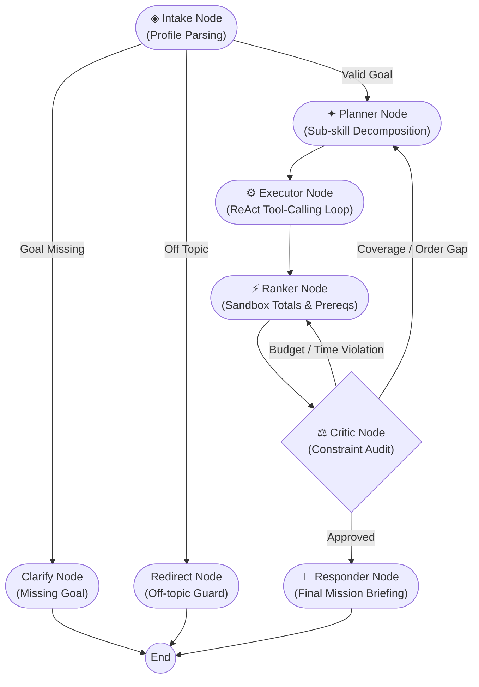

# Course Recommendation Agent · Mission Control

<div align="center">


**An autonomous agentic AI flight computer that plots verifiable, budget-aware, and time-optimized 5-stage career learning trajectories.**

[Live Demo](#quickstart) • [Architecture](#architecture) • [UI Showcase](#visual-showcase) • [Demo Walkthrough](#evaluator-demo-script) • [Project Layout](#project-layout)

</div>

---

## Overview

The **Course Recommendation Agent** transforms course recommendation from a generic chatbot into a **Mission Control Flight Computer**. Instead of returning random lists of links, the agent acts as an autonomous trajectory planner: decomposing ambitious career targets (e.g., *AI & GenAI Agent Engineer*, *Data Scientist*, *Cloud & DevOps Specialist*) into verified, progressive 5-milestone learning tracks.

Every trajectory is constrained by the learner's **weekly bandwidth**, **timeline (weeks)**, and **budget (INR)**, validated through an isolated sandbox execution loop, audited by a critic node, and rendered as a vertical metro route map.

---

## Architecture

The system is powered by a cyclic **LangGraph** state machine equipped with conditional edges, dynamic tool routing, isolated Python code execution, and checkpointer state retention:



### LangGraph Node Responsibilities

| Node | Function & Agent Logic | Rubric Focus |
|---|---|---|
| **`intake`** | Extracts structured profile (`goal`, `current_skills`, `time_weeks`, `hours_per_week`, `budget_inr`). | State initialization & input normalization. |
| **`planner`** | Decomposes target career goal into 3–5 progressive learning sub-skills. | Hierarchical planning & task decomposition. |
| **`executor`** | ReAct tool-calling loop selecting across 6 specialized tools. | Multi-tool autonomous execution. |
| **`ranker`** | Sequences candidates, checks prerequisite gaps, and calculates exact hours/cost using an isolated Python sandbox. | Deterministic computation & constraint ranking. |
| **`critic`** | Audits route against time capacity, budget limit, and prerequisite order. Rejects with feedback (up to 2 retry loops). | Self-reflection, retry loops & guardrails. |
| **`responder`** | Synthesizes an executive mission briefing with direct course links and alternative route options. | User-facing response generation. |

### Specialized Tools

1. **`search_course_db`**: Fast keyword & metadata queries over local SQLite catalog (165 curated courses across AI, ML, Cloud, DevOps, and Data Science).
2. **`web_course_search`**: Keyless DuckDuckGo search for real-time course discovery beyond the catalog.
3. **`check_prerequisites`**: Verifies prerequisite DAGs (e.g., Python required before Deep Learning).
4. **`python_sandbox`**: Safe in-memory Python execution calculating workload sums, weekly distributions, and constraint checks.
5. **`save_profile` / `load_profile`**: Disk-backed persistent user profile memory in `memory/`.

---

## End-to-End Curricula Tracks

The agent plots complete **5-Stage Progressive Roadmaps** containing direct, verified course links:

```
[Stage 1: Foundations] ──> [Stage 2: Core Engineering] ──> [Stage 3: Intermediate ML] ──> [Stage 4: Advanced AI / LLMs] ──> [Stage 5: Production Agents & MLOps]
```

### Supported Specialization Tracks
* **AI & GenAI Agent Engineer Track**:
  1. *Python for Everybody* (Coursera / U. Michigan)
  2. *Hugging Face NLP Course* (Hugging Face)
  3. *Generative AI with Large Language Models* (Coursera / DeepLearning.AI & AWS)
  4. *Building & Evaluating Advanced RAG* (DeepLearning.AI)
  5. *AI Agents in LangGraph* (DeepLearning.AI)
* **Data Science Specialist Track**:
  1. *SQL for Data Science* (Coursera / UC Davis)
  2. *Data Analysis with Python* (freeCodeCamp)
  3. *Machine Learning Specialization* (Coursera / Andrew Ng)
  4. *Practical Deep Learning for Coders* (fast.ai)
  5. *Generative AI with LLMs* (DeepLearning.AI)
* **Cloud & DevOps / MLOps Track**:
  1. *CS50 Introduction to Computer Science* (Harvard / edX)
  2. *DevOps with Docker* (University of Helsinki)
  3. *AWS Cloud Practitioner Essentials* (AWS Skill Builder)
  4. *Data Engineering Zoomcamp* (DataTalks.Club)
  5. *MLOps Zoomcamp* (DataTalks.Club)

---

## Quickstart

### Prerequisites
* Python 3.10 or higher
* Git

### 1. Installation

```bash
# Clone the repository
git clone https://github.com/your-username/course-recommendation-agent.git
cd course-recommendation-agent

# Create and activate virtual environment
python3 -m venv .venv
source .venv/bin/activate       # On Windows: .venv\Scripts\activate

# Install dependencies
pip install -r requirements.txt
```

### 2. Configure Environment

Copy the `.env.example` file to `.env`:

```bash
cp .env.example .env            # On Windows: copy .env.example .env
```

Edit `.env` to configure your preferred free LLM provider:

```env
# Recommended: Groq Free Tier (Fast inference with tool calling)
LLM_PROVIDER=groq
GROQ_API_KEY=gsk_your_groq_api_key_here
GROQ_MODEL=openai/gpt-oss-120b
GROQ_FALLBACK_MODEL=openai/gpt-oss-20b

# Alternative: Google Gemini Free Tier
# LLM_PROVIDER=gemini
# GOOGLE_API_KEY=your_gemini_api_key_here
# GEMINI_MODEL=gemini-2.5-flash

# Alternative: Fully Offline Local LLM (Ollama)
# LLM_PROVIDER=ollama
# OLLAMA_MODEL=llama3.1

# Simulation switches (0 = live, 1 = simulated outage)
SIMULATE_WEB_FAILURE=0
```

> **Note on Free Keys**: Get a free Groq API key in 30 seconds at [console.groq.com/keys](https://console.groq.com/keys), or a Google Gemini key at [aistudio.google.com](https://aistudio.google.com/apikey).

### 3. Launch

```bash
# Option A: Streamlit Mission Control Web UI (Recommended)
streamlit run app.py

# Option B: Terminal CLI Interface
python cli.py

# Option C: Offline Unit & Sanity Test Suite (No API key needed)
python test_offline.py
```

The web application opens at `http://localhost:8501`.

---

## Evaluator Demo Script

Follow this 5-step walkthrough to inspect all evaluation rubric points:

### Step 1: Complex Trajectory Generation
* **Action**: Click the preset card **"✦ AI & GenAI Agent Engineer"** (or type `"I know basic Python and want to become an AI Agent Engineer in 12 weeks, 10 hours/week, budget free"`).
* **Verify**:
  * Flight Deck **Pipeline** lights up node by node (`intake` $\rightarrow$ `planner` $\rightarrow$ `executor` $\rightarrow$ `ranker` $\rightarrow$ `critic` $\rightarrow$ `responder`).
  * Live **Console** streams tool calls with timestamps and expandable JSON details.
  * Station cards render with workload share bars, ratings, and clickable `Open course ↗` buttons.
  * Circular SVG **Vitals** display animated budget, load, and coverage percentages.

### Step 2: Conversational State Retention
* **Action**: Type `"Make it cheaper, only free courses."`
* **Verify**:
  * Agent preserves career context without needing to restate the goal.
  * Graph checkpointer re-ranks candidates and filters out paid courses.
  * `TOTAL COST` stat tile updates to `FREE` / `₹0`.

### Step 3: Constraint Violation & Critic Replan Loop
* **Action**: Type `"I only have 3 hours a week for this."`
* **Verify**:
  * Critic node detects workload overflow (`10h/week needed > 3h capacity`).
  * Critic rejects trajectory and triggers the curved amber retry edge back to `ranker`.
  * Amber warning tag appears in the Flight Console and stat tile flags `⚠ Review Load`.

### Step 4: Web Search Outage & Self-Correction
* **Action**: Open the top-right gear popover `⚙`, toggle **Simulate web-search outage**, and submit a query.
* **Verify**:
  * DuckDuckGo search simulates a 503 outage.
  * The executor catches the error, logs a `SELF-CORRECT` reflection, and falls back to the local SQLite database.
  * Toast notification surfaces: `"Fell back to local catalog"`.

### Step 5: Upstream Rate Limit (429) Resilience
* **Action**: Toggle **Autonomous Flight Computer** in the `⚙` popover, or query repeatedly on a free Groq tier.
* **Verify**:
  * If Groq returns `429 - Rate limit reached`, the agent catches the exception without crashing, notifies the user via toast, and completes the trajectory plotting locally.

---

## Project Layout

```
course-recommendation-agent/
├── agent/                         # Core Agentic Intelligence (LangGraph)
│   ├── __init__.py                # Package root
│   ├── db.py                      # SQLite course catalog engine & seed logic
│   ├── graph.py                   # LangGraph state machine, nodes & conditional edges
│   ├── llm.py                     # LLM factory, fallback cascade & JSON extraction
│   └── tools.py                   # ReAct tools (catalog, web search, sandbox, prereqs)
├── data/                          # Data Layer
│   ├── courses.csv                # 165 curated courses with skills, levels, hours, prices
│   └── courses.db                 # Auto-seeded SQLite database (git-ignored)
├── memory/                        # Long-term Agent Memory
│   └── .gitkeep                   # Disk-backed user profile persistence directory
├── screenshots/                   # Visual Portfolio Showcase Assets
│   ├── 1_empty_hero.png           # Hero launchpad view
│   ├── 2_mid_run_active.png       # Live Flight Deck view
│   ├── 3_finished_route_map.png   # Metro route map view
│   ├── 4_error_fallback.png       # Error & self-correction view
│   └── 5_mobile_width.png         # Responsive mobile view
├── .streamlit/                    # Streamlit Configuration
│   └── config.toml                # Dark theme tokens, font definitions & headless flags
├── app.py                         # Production Streamlit UI (Mission Control)
├── cli.py                         # Terminal CLI interface
├── styles.py                      # Mission Control CSS stylesheet
├── test_offline.py                # Standalone sanity test suite (zero API keys needed)
├── requirements.txt               # Production Python dependencies
├── .env.example                   # Environment variable template
└── README.md                      # Comprehensive project documentation
```

---

## Environment Variables

| Variable | Default | Description |
|---|---|---|
| `LLM_PROVIDER` | `groq` | Primary LLM provider (`groq`, `gemini`, `ollama`). |
| `GROQ_API_KEY` | *None* | API key for Groq Cloud. |
| `GROQ_MODEL` | `openai/gpt-oss-120b` | Primary Groq model (supports tool calling). |
| `GROQ_FALLBACK_MODEL` | `openai/gpt-oss-20b` | Secondary model for fallback when limits are reached. |
| `GOOGLE_API_KEY` | *None* | API key for Google Gemini (`LLM_PROVIDER=gemini`). |
| `GEMINI_MODEL` | `gemini-2.5-flash` | Gemini model name. |
| `OLLAMA_MODEL` | `llama3.1` | Local Ollama model name (`LLM_PROVIDER=ollama`). |
| `SIMULATE_WEB_FAILURE` | `0` | Set to `1` to test self-correction on search failure. |

---

## Technology Stack

* **Orchestration**: [LangGraph](https://github.com/langchain-ai/langgraph) & [LangChain Core](https://github.com/langchain-ai/langchain)
* **Frontend**: [Streamlit](https://streamlit.io/) with custom DOMPurify-safe HTML/CSS injections
* **Inference**: [Groq](https://groq.com/) (LPU inference engine), [Google Gemini](https://ai.google.dev/), [Ollama](https://ollama.com/)
* **Catalog & Data**: SQLite3 & Pandas
* **Search**: Keyless DuckDuckGo (`ddgs`)
* **Styling**: Google Fonts (*Space Grotesk*, *Inter*, *JetBrains Mono*) with responsive CSS Grid/Flexbox

---

## License

This project is licensed under the MIT License — see the [LICENSE](LICENSE) file for details. Built for educational and portfolio demonstration.
